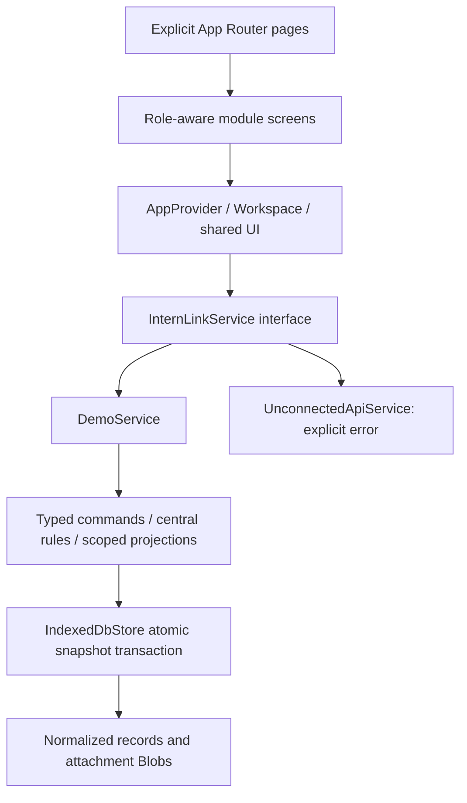

# Implemented front-end architecture

Next.js App Router 16.4.6 / React 19.3 / strict TypeScript / existing global CSS are preserved. There are no route handlers, server actions, SQL libraries, migrations or backend services. Explicit thin pages pass route parameters to module components in `app/features/`. Installed Next guides were consulted for async params, layouts/client boundaries, navigation/native history, error handling, tests and build directories.

| Boundary | Source / responsibility |
| --- | --- |
| Domain | `app/lib/domain.ts`: entities, enums, inputs, Command union, errors, DataStore and InternLinkService. |
| Rules | `rules.ts`: eligibility, allocation, relationships, hours, permissions, completion and reporting gap. |
| Commands | `commands.ts`: role checks, field validation, legal transitions, audit history, related atomic writes and read projections. |
| Persistence | `storage.ts`: schema validation and native IndexedDB readwrite transactions; `integrity.ts`: references/uniqueness/capacity/obligation validation. |
| Identity/service | `service.ts`: public demo credential verifier, expiring non-secret session marker, scoped reads, revision/idempotency, notifications, file reads and deliberate reset. |
| Seed | `seed.ts`: coherent fictional accounts/profiles, partnerships, requirements/real TXT Blobs, applications, placements/reports/evaluations/certificate. Relative dates calculated once at initialization. |
| Reporting | `reporting.ts`: seven category projections, filters/totals, exact snapshot CSV with escaping/formula mitigation. |
| UI | `AppProvider.tsx`: load/error/retry and mutation synchronization; `Workspace.tsx`: auth/navigation; `ui.tsx`: labelled fields, guarded async forms, native modal, URL filters, tables and record states. |
| Features | One component module per business area, composed by `PortalPage.tsx`; selection/display state is local, domain mutations are persistent service commands. |

The service interface is deliberately small: signIn, signOut, currentAccount, read, execute, attachment, reset and subscribe. `execute` accepts a discriminated typed command, caller request ID and optional expected revision, returning the saved record ID. UI code does not open IndexedDB. Future HTTP adapters map these operations to approved DTOs; the snapshot read may be assembled from authorized paginated resources. Do not expose a raw unrestricted database endpoint.

One versioned IndexedDB snapshot includes normalized arrays and Blob attachments. This simplifies cross-entity atomicity for an academic demonstration; every mutation reads/validates/updates/writes in one readwrite transaction. Schema version 1 has no migration path yet; unsupported/damaged datasets display an error until explicit recovery. Ordinary reads never overwrite saved data with seed data. Bounded receipts (200) deduplicate recent retries; revisions reject stale writes. Long-term domain uniqueness independently guards repeated placement/application/report/evaluation creation.

Provider reads refresh after writes, BroadcastChannel events, session storage events, window focus and a 30-second refresh. A generation counter prevents stale responses replacing newer state. Cross-tab writes are serialized by IndexedDB; stale forms get a conflict and retain input. URL filters use Next's documented native history integration and current `window.location.search` in handlers, preventing rapid reset/change races. Component forms are not recreated just because a refresh returns a new snapshot.

Names and company/student context are resolved from foreign keys. Submitted and reviewed totals are distinct; capacity is derived from non-terminated placements. `availability` is a read-only projection computed before role scoping so students see correct availability without unrelated student records. Required document IDs are intentionally snapshotted on each placement so later master-definition additions do not retroactively invalidate it.

The public synthetic password is hashed to a verifier for stored accounts; no plaintext password or production token is persisted. localStorage stores only an account ID and expiry for the eight-hour simulated session. Read projections remove verifiers and unrelated records, and command guards check current role/assignment. Users can inspect/alter their own browser: none of this is production authorization, encryption or tamper resistance.

Search inputs retain browser text while URL transitions settle. A current-location guard and filter/history events synchronize external changes without restoring stale characters; actual zero-delay keystrokes and immediate reset are regression tested. Recovery reset distinguishes record-store corruption from a session-storage exception, preserving valid records in the latter case.

Forms wait for actual service completion; failed writes preserve relevant fields and focus feedback. Native HTML validation plus central command validation reject invalid inputs. Dialogs support Escape, modal keyboard focus and focus restoration. Shared record/loading/empty/error/success states prevent invalid IDs from dereferencing undefined records. Desktop/mobile table shells scroll horizontally; retained text/density/motion preferences affect rendered CSS. No redesign framework was added.

Testing uses Vitest for rules, Testing Library for async form interactions, fake-indexeddb for actual adapter integration and Playwright/axe for production browser workflows. See TEST_PLAN/TEST_REPORT. Tests do not establish production backend or universal accessibility conformance.

## Verification repair notes

Readonly IndexedDB access avoids rewrites and permits loading intact data when writes fail. Startup failures are retryable. Mutations still validate and commit one shared snapshot atomically; the UI holds a form-specific expected revision through background refresh. See D-033/034 for conflict behavior.

Command fingerprints are computed before opening a transaction. Persisted optional receipt fingerprints bind actor/request key to intent and file bytes; legacy receipts remain readable but conflicting/ambiguous replay is rejected. This is bounded browser-local idempotency, not a permanent server audit trail. Reset is explicitly confirmed and ordered to preserve records when session clearing fails (D-040).
