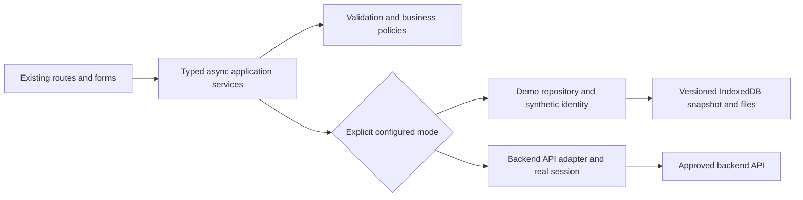

# Proposed application architecture

**Design proposal only; not implemented in Phase 0.** Retain Next.js 16.4.6 App Router, React 19.3, TypeScript and existing CSS. Do not replace the working UI or introduce a second framework. Installed Next documentation is the authority for framework APIs; relevant guides are listed in REPOSITORY_AUDIT.

## Small layers with explicit ownership

Proposed folders: `app/` for routing and page composition, `components/` for reusable form fields/table controls/status/dialog states, `lib/domain/` for types/selectors/policies, `lib/services/` for use cases/interfaces, `lib/adapters/demo/` for seed and storage, `lib/adapters/api/` for fetch/DTO mapping, and `tests/` for focused tests. These paths are planned, not existing implementation locations. Avoid generic repository frameworks, event buses, microservices or global state libraries until demonstrated need.

Services expose async methods and return domain objects or typed results. Examples: students.list/get/create/update; partners.list/get/create/update and supervisors.list/create/update; requirements.list/create/update and submissions.list/get/submit/review; opportunities.list/get/create/update/approve; applications.list/get/decide; placements.list/get/create; progress.list/getReport/review; evaluations.list/get/submit; reports.generate; preferences.get/update; auth.current/signIn/signOut/canAccess. Commands are use cases (decide/createPlacement/review), not arbitrary field patches that bypass rules.

Pages never import seed arrays after migration. Keep server components for API-backed read composition when feasible; interactive forms/directories are client components. A browser-only demo service needs a client provider/boundary and explicit hydration/loading state; do not render the browser database in server components or at build time. Do not serialize an API credential through that provider. A small context plus hooks can expose services and revision-driven reads; refresh affected queries after successful writes. Add a query library only if this becomes insufficient.

## Persistent synthetic demonstration mode

Use a small native IndexedDB database such as `pup-internlink-demo-v1`, with a versioned normalized snapshot and a Blob/file store. One readwrite transaction writes the snapshot, related file references and monotonically increasing revision together. This avoids inconsistent multi-key localStorage writes and supports submission previews after reload. A wrapper should be small and tested, not an elaborate offline sync engine. Use localStorage only for non-sensitive display preferences if necessary, with a separate versioned namespace. The exact storage choice is recommended and still reviewable (D-004).

Seed once with stable synthetic IDs and example.test/example.com contact addresses; no real account/password or institutional student data. Referential checks run when generating the seed. Empty seed, reset, storage denied/quota, interrupted transaction, unsupported schema version and corrupted snapshot need explicit results. Never silently reset data after corruption. Provide an explicit demo-only reset and confirmation describing what synthetic data will be cleared. Keep an injected clock/ID generator for reproducible tests. For multiple tabs, serialize transactions and reject stale revisions; notify other tabs to refresh (a simple BroadcastChannel if needed). No automatic upload or cross-device sync.

Every persistent write must update all affected relationships and aggregates. Derive counts/remaining hours/completion/evaluation summaries from one snapshot. File metadata includes owner and placement/student context, MIME, size and safe display name. Object URLs are temporary presentation handles and must be revoked; store Blobs or opaque IDs, not object URLs as durable data. Demo files are local synthetic material; local authorization simulation is not security against a browser owner.

## Isolation from production API behavior

Choose mode once in an explicit configuration/composition root; validate missing/invalid values. Display an unmistakable Demonstration mode indicator in demo and explain local persistence. Production builds configured for API mode import/use only the API adapter and real session source. The API adapter never reads/writes demo storage, and network/authorization/schema errors must never fall back to fixtures. Test these negative boundaries. Changing modes does not migrate, merge or upload local demo records. API request logs and errors must not expose credentials or document contents. Keep secrets server-side; public configuration may contain a public base URL/mode only.

Production session behavior is backend-owned. Prefer secure server-managed cookie sessions if the backend supports them; confirm CSRF/CORS/session refresh requirements in the contract. Front-end route and action checks improve UX but server authorization remains mandatory. A synthetic demo sign-in selects a clearly labelled seeded identity and must never pretend to validate real credentials. Student profile creation and account provisioning remain separate commands pending BR-Q02.

## Central validation and policy

Validate at form boundaries for feedback and again at services for invariants; backend repeats authoritative validation. Use typed pure validators or one small schema library after checking compatibility. Required strings are trimmed, emails normalized for comparison, IDs opaque, dates ISO local dates, numeric inputs parsed as finite positive values where appropriate. Return field errors with stable codes. Do not silently coerce invalid dates or accept blank strings as zero. Duplicate constraints, state transitions and relationship eligibility belong in application services, not duplicated click handlers.

Confirmed PDF constraints include accepted application before placement, one placement per application, same-company supervisor, registered faculty, mandatory submissions, application/placement status domains and evaluation count/assignment restrictions. Unresolved policies are injected explicitly; production actions requiring a missing policy return a clear configuration error instead of inventing an approved business rule. See BUSINESS_RULES for the distinction between submission and approval, slots, overlapping placements and completion.

Decision/create-placement transactions must be atomic in demo and backend. Use expected revision/idempotency for retryable commands; disable double submission while pending, but do not rely on button disabling for uniqueness. API mode treats the server response as authoritative and handles 409 conflicts by rereading the record. Do not automatically retry non-idempotent mutations.

## Navigation and states

Use a shared route builder and validated query parser. Preserve existing `/dashboard/internships` URLs for Opportunities. Suggested query keys are `student`, `company`, `opportunity`, `status`, `q`, `sort`, `academicYear`; translate IDs consistently. Search/filter/sort changes should be reflected in the URL so reload/back/forward and cross-page navigation agree. Use installed Next page/searchParams and client navigation APIs; avoid a one-time window.location effect. Invalid/missing IDs should use a consistent not-found presentation/status, acknowledging streamed response semantics documented by Next.

Every asynchronous read needs loading, empty and error/retry states; every command needs submitting, field/domain errors and verified success feedback. A success message follows an actual adapter write, with redirect only after the new entity is readable. Reuse the current empty-directory pattern. Shared fields need associated labels/errors; status changes need live announcements; dialog must trap focus, support Escape, restore focus, and have an accessible name. Keep horizontal table scrolling, repair viewport overflow and mobile navigation without redesigning the visual system.

## Verification approach

- Unit: validators, selectors, date/hour/eligibility policies and transitions; meaningful edge cases, not assertions mirroring implementation.
- Component: real user input and accessible labels, validation/rejection guards, submission states, review dialog keyboard behavior and failure feedback.
- Adapter integration: identical service conformance cases for demo/API mocks, atomic writes, rollback, duplicate/conflict, storage version/reset, files/reload and explicit mode isolation. Actual backend conformance awaits a test API.
- E2E: Playwright against a production build with isolated synthetic storage, scenarios A-D plus requirements/report/settings flows. Test reload/navigation consistency, direct URL guards, negative paths and two tabs where revisions matter. Chromium initially; add WebKit/Firefox and keyboard/assistive technology coverage before final release.

TEST_PLAN contains the gates. Phase 0's observation harness is audit evidence, not the future acceptance suite. No test runner, persistence adapter, domain layer, API client or permission system was installed into the application during this phase.
