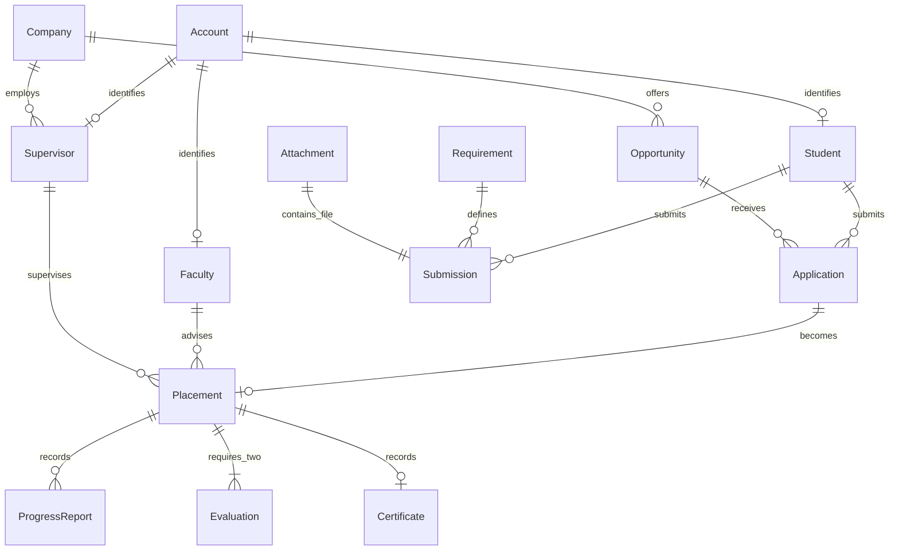

# Front-end data contracts

**These are implemented synthetic front-end contracts, not an approved ERD or SQL schema.** Authoritative TypeScript fields/enums are in `app/lib/domain.ts`; seed and integrity checks are in `seed.ts`/`integrity.ts`. Production key mapping must be agreed with the receiving backend team.

| Entity | ID, fields and relationships |
| --- | --- |
| Account | Opaque `id`; name, unique case-insensitive email, Role, active, activationState, credentialVersion, demo verifier. Public read projections blank verifier. |
| Student | Opaque id; unique public studentNumber; accountId → Student account; firstName,lastName,email,program,yearLevel,section,academicYear; optional adviserId → Faculty and registeredBy → Account. Email/name account mirror is updated atomically. |
| Faculty | id; accountId → Faculty Adviser account. Coordinator-managed faculty accounts are selectable, with current student assignments before placement. |
| Company | id; unique name/contact email, industry,address,contactPerson,email,phone,moaStart,moaEnd,approved,academicYear. Partnership status is derived. |
| Supervisor | id; accountId → Company Supervisor administrative or Intern Supervisor operational account; companyId → Company; phone. One company affiliation; no transfer operation. |
| Requirement | id; unique name,description,classification Mandatory/Optional, phase Before Internship/During Internship/After Internship. |
| Attachment | id; name,mime,size and actual Blob; Submission.fileId references it. No filesystem path/public API URL stored. |
| Submission | id; studentId,requirementId,fileId; attempt,submittedAt,status; optional reviewerId → Account,reviewedAt,reason. Attempts retained; latest attempt drives checklist. |
| Opportunity | id; companyId,title,description,positive integer capacity,status,academicYear; location,modality,requiredHours,qualifications,skills,responsibilities; supervisorIds → operational Supervisor profiles; decisions and assignmentHistory. Remaining capacity and Filled status are derived. |
| Application | id; studentId,opportunityId,submittedAt,status,academicYear; history of status/actorId/time/reason. Unique student/opportunity pair. |
| Placement | id; unique applicationId,adviserId → Faculty,supervisorId → Supervisor; startDate,endDate,requiredHours,status,approvedBy → Account,createdAt,academicYear; requiredRequirementIds snapshot; optional terminationReason/completedAt/assignmentHistory. Student/opportunity/company derive through application. |
| ProgressReport | id; placementId,workDate,hours,tasks,submittedAt,status,remarks; optional reviewerId/reviewedAt. Daily or Weekly; periodEnd,attendanceIds,attempt,history,facultyRemarks,legacyStatus,replacesId. Only one non-rejected daily attempt per placement/workDate. |
| Evaluation | id; placementId,evaluatorId → Account,status; optional grade,comments,submittedAt,evaluationDate until submitted. Exactly one obligation for each assigned faculty/company evaluator, created with placement. |
| Certificate | id; unique placementId/number,issueDate,recordedBy → Account. Actual synthetic metadata only for completed eligible placement. |
| Activity | id; actorId,at,message,href; latest 300 events retained for local activity view. |
| Preferences | Per-account dictionary: academicYear,landingPage,density, four local alert flags,largerText,reduceMotion. |
| Snapshot | schemaVersion 2,revision, all normalized collections,preferences and latest 200 request receipts. Optional availability map exists only in scoped read projection. |

IDs are opaque strings (seed IDs are readable; new IDs use crypto.randomUUID); public student/certificate numbers are separate. Dates use ISO YYYY-MM-DD; audit times ISO UTC strings; local presentation formats timestamps. Seed dates are relative to reset time. Hours/scores are finite numbers, capacity integer. No floating final grade/weight/pass policy is invented.

Persisted status values: Role = Coordinator (display OJT Coordinator)/Student/Faculty Adviser/Company Supervisor/Intern Supervisor; Application = Pending/Accepted/Rejected; Placement = Ongoing/Completed/Terminated; Submission = Pending/Approved/Rejected; Opportunity = Pending Approval - Company/Pending Approval - Coordinator/Approved/Active/Deactivated/Rejected, with Filled derived; Report = Pending/Approved/Rejected; Evaluation = Pending/Submitted. Partnership = Pending/Active/Expiring Soon/Expired is computed, not mutable.

Derived values never become separate mutable counters: display names, student placement state, remaining slots, rendered/approved/remaining hours, completion percentage, evaluation counts and report/dashboard totals. Term strings on historical application/placement records and requiredRequirementIds are deliberate snapshots. Company/student names resolve live; prior report output is an intentional generated snapshot until regenerated.

Integrity validation detects malformed collections, duplicate IDs, core foreign-key/role relationships, application uniqueness, duplicate placements/reports, wrong-company supervisors, capacity excess, missing/extra evaluator obligations and invalid file Blob metadata. Browser data can still be manually tampered with; authoritative production validation, constraints, privacy and transactions are backend responsibilities. See BUSINESS_RULES and API_CONTRACT.

## Verification-compatible receipt extension

Version 1 receipts now optionally contain commandFingerprint: string (64 lowercase hexadecimal SHA-256 characters). New commands always write it. Existing receipts without it are valid to read; replay requires a new reviewed request key. Optional receipt fingerprints did not require a reset. The later interface update supplies an atomic version-one to version-two upgrade, described below. Account/profile associations must be unique per profile type; submitted grades must be finite. Native attachment Blobs remain in IndexedDB, never duplicated as base64 in records.

## Version-two extensions and compatibility

| Record | Fields and invariants |
| --- | --- |
| AccountRequest | id is a local demonstration code; accountId, purpose Activation/Password Reset, createdAt, expiresAt, optional createdBy/usedAt. Bound to existing account/email, one use. No plaintext password. Not a production token. |
| Attendance | id,placementId,date,hours,activity,createdAt,optional reportId. Unique placement/date; reportId points to latest weekly attempt containing its ID. Previous rejected report references remain history. |
| Posting decision | stage Company/Coordinator/Legacy; outcome Approved/Rejected/Activated/Deactivated/Edited; actorId,at,remarks. Historical attribution preserved; it is not a third independent application status. |
| Assignment history | Opportunity from/to Supervisor ID arrays or Placement from/to Supervisor ID; actorId,at. Placement's pending company evaluation changes evaluator in-place, never adds an obligation. |
| Progress history | status,actorId,at,remarks per decision; facultyRemarks has separate id,actorId,at,text. Weekly hours equal linked attendance sum; no duplicate approved attendance reference. |
| Session | accountId,expiresAt,optional credentialVersion. Credential changes increment account version, invalidating prior sessions. Not a bearer security boundary. |
| Availability projection | remaining,eligible,applications aggregate per opportunity, computed before scope filtering with service clock; never persisted as a mutable counter. |

Migration retains every existing entity ID, student number, verifier, attachment Blob, receipt, preference, application history, placement, evaluation and certificate. It adds pending-state metadata and initializes attendance/request arrays. Legacy supervisors map to Intern Supervisor with unchanged profile/placement/evaluator IDs; no administrator account is invented. A current adviser is derived from ongoing/latest historical placement when available. All legacy requirements map to Before Internship. Legacy Approved postings map to Active with `legacyApproval=true`; Closed maps to Deactivated; old Pending Approval maps to Pending Approval - Company. New attributes are explicitly Not specified/undefined rather than fabricated institutional facts. Legacy placement supervisors seed corresponding opportunity assignments within their company.

Legacy Reviewed reports become Approved with `legacyStatus=Reviewed` and retained original reviewer/timestamp; no claim is made that the reviewer had the newly introduced role at the historical time. Pending Review becomes Pending. Existing approved hour totals do not change. Submitted evaluations get their recorded date from submittedAt. Unknown snapshot versions fail visibly. No migration reseeds or deletes saved data; an interrupted/failed write leaves the original version-one snapshot intact. Version-one enums remain in the TypeScript union solely for validation/upgrade compatibility; new writes use the new states.

Daily/weekly overlap, attendance uniqueness, linked placement/date/hours integrity, role affiliations and two-obligation integrity are checked before persistence. Exact field-to-approved-ERD mapping remains UNVERIFIED. Backend developers must implement durable keys, constraints and transactional history independently of this browser snapshot representation.

## Final review compatibility

The final review introduced no schema version or seed reset. Existing version-two relationships and the genuine version-one upgrade remain unchanged. Administrative email/activation edits advance the existing credential version and invalidate existing access requests. Active/Filled/report display remains derived from existing opportunity state/capacity; rendered and approved hour fields are projections, not duplicated mutable totals.
