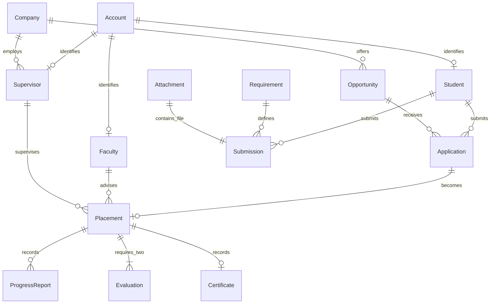

# Front-end data contracts

**These are implemented synthetic front-end contracts, not an approved ERD or SQL schema.** Authoritative TypeScript fields/enums are in `app/lib/domain.ts`; seed and integrity checks are in `seed.ts`/`integrity.ts`. Production key mapping must be agreed with the receiving backend team.

| Entity | ID, fields and relationships |
| --- | --- |
| Account | Opaque `id`; name, unique case-insensitive email, Role, active, demo verifier. Public read projections blank verifier. |
| Student | Opaque id; unique public studentNumber; accountId → Student account; firstName,lastName,email,program,yearLevel,section,academicYear. Email/name account mirror is updated atomically. |
| Faculty | id; accountId → Faculty Adviser account. Registered seed faculty are selectable; faculty account administration is outside specified coordinator scope. |
| Company | id; unique name/contact email, industry,address,contactPerson,email,phone,moaStart,moaEnd,approved,academicYear. Partnership status is derived. |
| Supervisor | id; accountId → Company Supervisor account; companyId → Company; phone. One company affiliation; no transfer operation. |
| Requirement | id; unique name,description,classification Mandatory/Optional. |
| Attachment | id; name,mime,size and actual Blob; Submission.fileId references it. No filesystem path/public API URL stored. |
| Submission | id; studentId,requirementId,fileId; attempt,submittedAt,status; optional reviewerId → Account,reviewedAt,reason. Attempts retained; latest attempt drives checklist. |
| Opportunity | id; companyId,title,description,positive integer capacity,status,academicYear. Remaining capacity is derived. |
| Application | id; studentId,opportunityId,submittedAt,status,academicYear; history of status/actorId/time/reason. Unique student/opportunity pair. |
| Placement | id; unique applicationId,adviserId → Faculty,supervisorId → Supervisor; startDate,endDate,requiredHours,status,approvedBy → Account,createdAt,academicYear; requiredRequirementIds snapshot; optional terminationReason/completedAt. Student/opportunity/company derive through application. |
| ProgressReport | id; placementId,workDate,hours,tasks,submittedAt,status,remarks; optional reviewerId/reviewedAt. Unique placement/workDate. |
| Evaluation | id; placementId,evaluatorId → Account,status; optional grade,comments,submittedAt until submitted. Exactly one obligation for each assigned faculty/company evaluator, created with placement. |
| Certificate | id; unique placementId/number,issueDate,recordedBy → Account. Actual synthetic metadata only for completed eligible placement. |
| Activity | id; actorId,at,message,href; latest 300 events retained for local activity view. |
| Preferences | Per-account dictionary: academicYear,landingPage,density, four local alert flags,largerText,reduceMotion. |
| Snapshot | schemaVersion 1,revision, all normalized collections,preferences and latest 200 request receipts. Optional availability map exists only in scoped read projection. |

IDs are opaque strings (seed IDs are readable; new IDs use crypto.randomUUID); public student/certificate numbers are separate. Dates use ISO YYYY-MM-DD; audit times ISO UTC strings; local presentation formats timestamps. Seed dates are relative to reset time. Hours/scores are finite numbers, capacity integer. No floating final grade/weight/pass policy is invented.

Persisted status values: Role = Coordinator/Student/Faculty Adviser/Company Supervisor; Application = Pending/Accepted/Rejected; Placement = Ongoing/Completed/Terminated; Submission = Pending/Approved/Rejected; Opportunity = Pending Approval/Approved/Closed; Report = Pending Review/Reviewed; Evaluation = Pending/Submitted. Partnership = Pending/Active/Expiring Soon/Expired is computed, not mutable.

Derived values never become separate mutable counters: display names, student placement state, remaining slots, submitted/reviewed/remaining hours, completion percentage, evaluation counts and report/dashboard totals. Term strings on historical application/placement records and requiredRequirementIds are deliberate snapshots. Company/student names resolve live; prior report output is an intentional generated snapshot until regenerated.

Integrity validation detects malformed collections, duplicate IDs, core foreign-key/role relationships, application uniqueness, duplicate placements/reports, wrong-company supervisors, capacity excess, missing/extra evaluator obligations and invalid file Blob metadata. Browser data can still be manually tampered with; authoritative production validation, constraints, privacy and transactions are backend responsibilities. See BUSINESS_RULES and API_CONTRACT.
